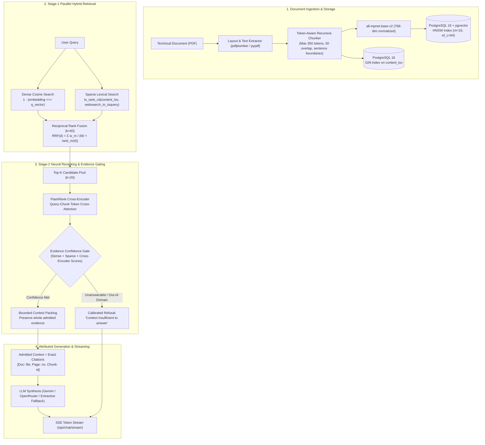

# Forge Hub RAG System

Backend hardening is in progress; frontend work is deferred.

> Hybrid retrieval-augmented generation backend under active hardening with HNSW vector indexing, reciprocal rank fusion, quantized cross-encoder reranking, and evidence-gated hallucination defense.

[](https://python.org)
[](https://fastapi.tiangolo.com)
[](https://nextjs.org)
[](https://typescriptlang.org)
[](https://github.com/pgvector/pgvector)
[](LICENSE)

---

## Architecture Overview

Naive RAG pipelines suffer from three systemic failure modes in production:
1. **Semantic Drift & Lexical Blindness:** Dense-only bi-encoders fail on exact technical identifiers, acronyms, and error codes; sparse-only BM25 fails on semantic paraphrasing.
2. **Context Distraction & Prompt Dilution:** Stuffing raw 500+ token chunks into an LLM context introduces irrelevant sentences, confusing long-context attention heads.
3. **Unchecked Hallucination on Unanswerable Queries:** Standard RAG pipelines force generation regardless of retrieved context quality, generating plausible-sounding fabrications.

Forge Hub addresses these failures with a two-stage hybrid retrieval and evidence-gated generation pipeline:



---

## Key Engineering Decisions & Trade-Offs

### 1. PostgreSQL 16 + pgvector vs. Standalone Vector Databases
* **Decision:** Consolidate relational metadata, document content, full-text indexes, and high-dimensional vector embeddings into PostgreSQL 16 with `pgvector` and `HNSW`.
* **Trade-Off:** Dedicated vector databases (Pinecone, Qdrant, Milvus) offer specialized distributed clustering for $100\text{M}+$ vectors. However, in enterprise document environments ($< 10\text{M}$ vectors), managing separate vector and relational stores introduces distributed state synchronization risks, dual authorization models, and eventual consistency lag. PostgreSQL provides single-transaction ACID guarantees, cross-table relational joins, cascading foreign keys (`ON DELETE CASCADE`), and transactional rollback on failed ingestions.

### 2. Reciprocal Rank Fusion (RRF) vs. Linear Score Summation
* **Decision:** Merge dense cosine similarity and sparse `ts_rank_cd` scores using rank-based Reciprocal Rank Fusion ($k=60$) rather than normalizing and adding raw scores:
  $$\text{RRF}(d) = \sum_{m \in M} \frac{w_m}{60 + \text{rank}_m(d)}$$
* **Trade-Off:** Dense cosine distances are bounded $[0, 1]$, whereas lexical BM25/`ts_rank_cd` scores are unbounded and sensitive to document length and term frequency. Directly combining them via weighted summation requires domain-specific score calibration that breaks when query distribution shifts. RRF relies exclusively on positional rank, guaranteeing robust, distribution-invariant fusion without manual calibration.

### 3. Strict 350-Token Chunk Boundary vs. 512-Token Default
* **Decision:** Enforce a strict ceiling of 350 tokens (with 50-token sliding overlap) during document segmentation.
* **Trade-Off:** While modern embedding models accept 512-token sequence lengths, `sentence-transformers/all-mpnet-base-v2` has an effective position embedding capacity of 384 tokens. Standard 512-token chunking results in silent truncation of the tail 128 tokens during embedding generation. Chunks count actual model tokens including special tokens, preserve source spans and split oversized units when necessary.

### 4. Stage-2 Quantized Cross-Encoder Reranking
* **Decision:** Implement a two-stage retrieval pattern pairing Stage-1 hybrid search (top-20 candidates) with Stage-2 FlashRank quantized ONNX cross-encoder reranking before prompt synthesis.
* **Trade-Off:** Bi-encoders embed queries and documents independently into vector space, missing fine-grained token-level cross-interactions. Full cross-encoders provide high precision but are computationally prohibitive to run across an entire database. A two-stage pipeline restricts cross-attention evaluation to the top-20 retrieved candidates, with the quality and latency trade-off measured by the diagnostic harness.

---

## Directory Structure

```text
Forge-Hub-RAG-System/
├── apps/
│   ├── backend/                     # FastAPI ASGI application
│   │   ├── app/
│   │   │   ├── chat.py              # Attributed chat & SSE streaming router
│   │   │   ├── config.py            # Environment configuration & pydantic-settings
│   │   │   ├── db.py                # asyncpg connection pool & dual-engine storage
│   │   │   ├── documents.py         # Multi-page PDF ingestion & token chunker
│   │   │   ├── embeddings.py        # SentenceTransformer embedding worker
│   │   │   ├── gating.py            # Evidence evaluator & bounded context packing
│   │   │   ├── main.py              # FastAPI app factory & lifecycle handlers
│   │   │   ├── retrieval.py         # Parallel dense + sparse hybrid RRF search
│   │   │   └── schemas.py           # Pydantic v2 domain models
│   │   ├── tests/                   # Offline contracts + opt-in real database/protocol tests
│   │   ├── requirements.txt         # Supported backend dependency bounds + platform lock
│   │   └── pyproject.toml           # Pytest & tool configurations
│   └── frontend/                    # Next.js 14 App Router UI
│       ├── app/                     # React Server Components & client views
│       ├── components/              # Modular UI components (Chat, Upload, Sources)
│       └── package.json
├── packages/
│   └── common/                      # Shared types and validation contracts
├── scripts/
│   ├── bootstrap.sql                # PostgreSQL 16 schema, HNSW & GIN DDL
│   ├── validate_db.sql              # Database verification script
│   └── benchmark_rag.py             # Reproducible latency & retrieval benchmark harness
├── docker-compose.yml               # PostgreSQL 16 + pgvector container definition
├── turbo.json                       # Turborepo monorepo pipeline configuration
└── README.md
```

---

## Quick Start

### 1. Configure Environment
Copy the example configuration and set `FORGE_HUB_POSTGRES_PASSWORD`, the local PostgreSQL DSN and
the trusted RS256 issuer, public key and audience. Gemini and OpenRouter are optional. Local
extraction is explicitly labeled when no provider is used. See the [backend setup](apps/backend/README.md)
for production migration/runtime identities and model warmup.

```bash
cp .env.example .env
```

### 2. Start PostgreSQL

```bash
docker compose up -d postgres
```

### 3. Migrate the Local Database and Launch the Backend

Apply the versioned migrations before the backend starts. For existing databases, follow the
backup and migration procedure in the [database setup guide](scripts/DB_SETUP.md).

```bash
cd apps/backend
python3.12 -m venv .venv

# On Linux/macOS:
source .venv/bin/activate
# On Windows:
.venv\Scripts\activate

# On the verified Windows/Python 3.12 platform:
pip install -r requirements.win-py312.lock
# Other platforms resolve requirements.txt and run the same verification gates.
python -m app.migrate --apply
uvicorn app.main:create_app --factory --reload --port 8000
```
* API Root: `http://localhost:8000`
* Interactive Documentation: `http://localhost:8000/docs`

### Existing frontend prototype (work deferred)
```bash
cd apps/frontend
pnpm install
pnpm dev
```
* Frontend Interface: `http://localhost:3000`

---

## API Endpoints

Every private `/api/*` route requires a signed Bearer token and an owned, explicit session scope.
The existing prototype must adopt this contract before integration; frontend work remains deferred.

| Method | Endpoint | Description |
| :--- | :--- | :--- |
| `GET` | `/health` | Process liveness; `/ready` separately checks readiness |
| `POST` | `/api/documents/upload` | Ingests multi-page technical PDFs, chunks at 350 tokens, and stores vectors |
| `GET` | `/api/documents` | Lists ingested documents scoped to the active session |
| `POST` | `/api/chat` | Non-streaming hybrid retrieval, evidence gating, and attributed answer synthesis |
| `POST` | `/api/chat/stream` | Server-Sent Events (SSE) streaming tokens with latency profiling metadata |
| `GET` | `/api/chat/history` | Fetches historical session turns with retrieval and generation latency metrics |
| `DELETE`| `/api/sessions/{session_id}` | Cascading deletion of session, chat history, documents, and embeddings |

---

## Verification & Testing

The test suite covers chunking boundaries, HNSW schema compatibility, Reciprocal Rank Fusion mechanics, score divergence, cross-encoder reranking, and evidence gating refusals.

Run the test suite from the repository root:
```bash
python -m pytest apps/backend/tests -v
```

Run diagnostics only against an explicit loopback disposable `forge_hub_test` database. It uses a temporary schema, actual handlers and local extraction; failed metrics cause a nonzero exit, and unmeasured triad metrics remain unmeasured:
```bash
python scripts/benchmark_rag.py --database-url "$FORGE_HUB_TEST_DATABASE_URL"
```

---

## License

This project is licensed under the [MIT License](LICENSE).
